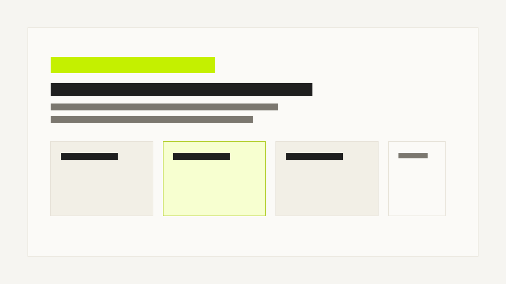

# voidlab-space：内容源与预览壳

## 一句话结论

以后你可以把内容写在这个 `space` 里，而不是继续和主代码仓的业务代码混在一起。

## 这个空间解决什么

- 把知识库内容源和主工程分开
- 保留本地预览能力
- 后面可以继续接入“同步到正式知识库”的流程

## 你怎么用

1. 在 `content/entries/<space-slug>/<section>/` 新建 Markdown
2. 保持 `npm run dev` 运行
3. 刷新浏览器，直接看最终样式

## 本地图片解析

下面这张图就是从 `content/assets` 里直接解析出来的，不需要先传到线上：

## 交付物

- 一个独立的 `voidlab-space` 目录
- 一个可运行的本地预览页
- 一套内容目录约定和模板

## 验收标准

- 新增一篇 Markdown 后，页面能看到它
- 标题、正文、列表、代码块能正常显示
- 左侧能切换 space 和文档

## 常见坑

- 文件路径不符合 `content/entries/<space-slug>/<section>/` 约定时，不方便后续做自动同步
- 没写 `title` 时会退回到文件名推断标题，预览能看，但正式内容最好还是明确写 frontmatter
